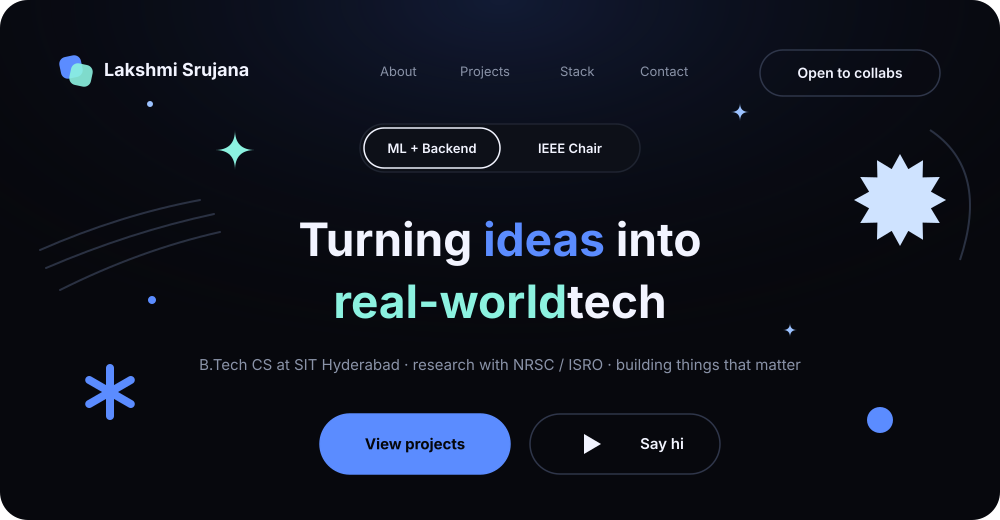
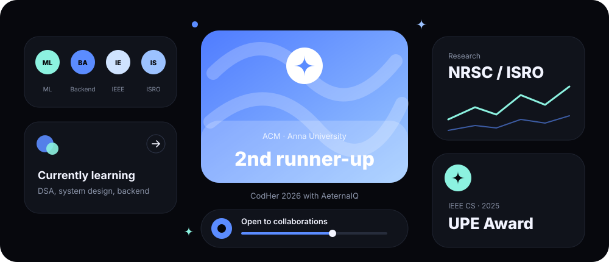
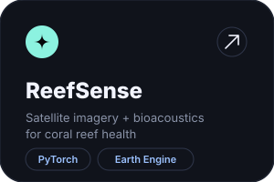
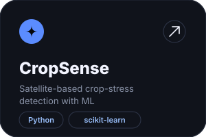
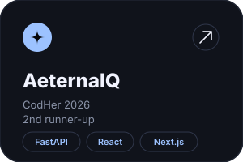
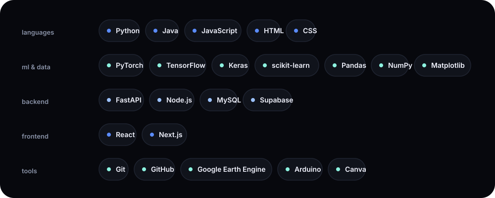

<div align="center">



<br>

<a href="https://www.linkedin.com/in/lakshmi-srujana-645535312/">linkedin</a> &nbsp;·&nbsp;
<a href="mailto:pvlsrujana@gmail.com">email</a>

</div>

<br>

### about

```python
srujana = {
    "studying": "B.Tech CS @ SIT Hyderabad",
    "leading":  ["IEEE Student Branch", "IEEE CS Chapter"],
    "research": "NRSC / ISRO",
    "into":     ["machine learning", "backend", "system thinking"],
    "goal":     "projects that actually matter",
    "open_to":  ["collabs", "ideas", "cool projects"],
}
```

<br>

### highlights



<br>

### projects

<a href="https://github.com/lakshmi-srujana/REPO-NAME"></a>
<a href="https://github.com/lakshmi-srujana/REPO-NAME"></a>
<a href="https://github.com/lakshmi-srujana/REPO-NAME"></a>

<br>

### stack



<br>

### now

```diff
+ building ML projects with real-world impact
! grinding DSA
! learning backend + system design
# long-term: ML engineer in Japan
```
